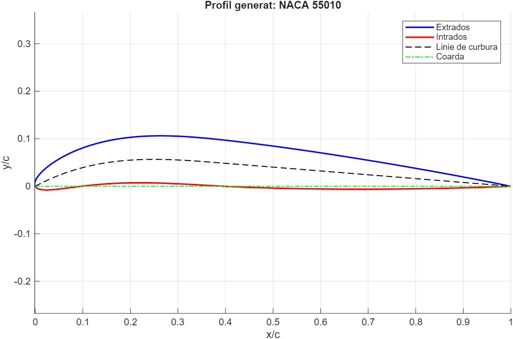
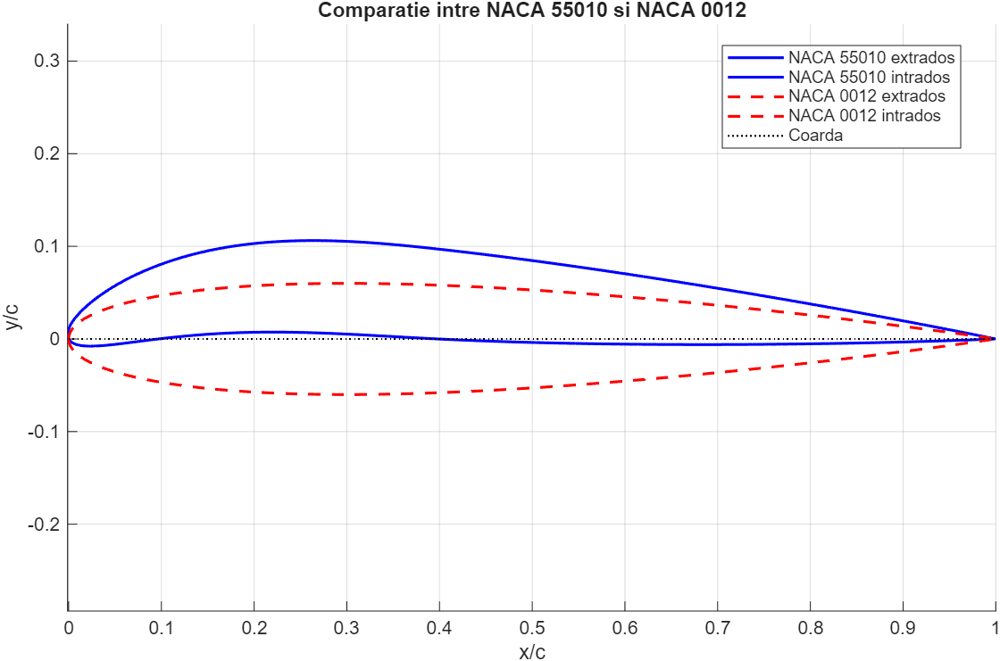
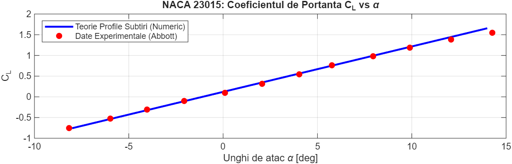
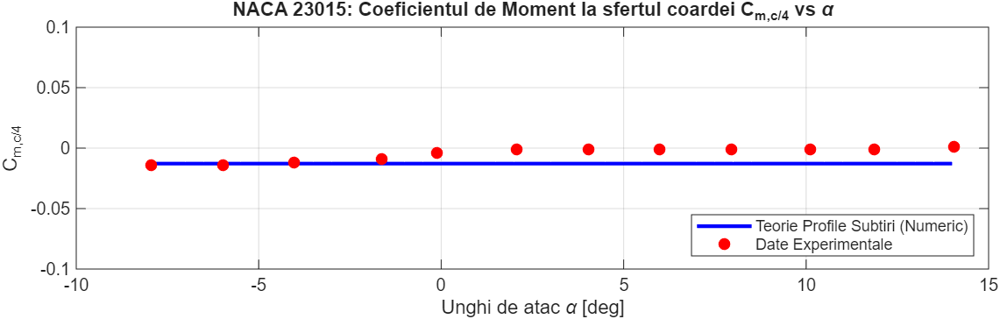
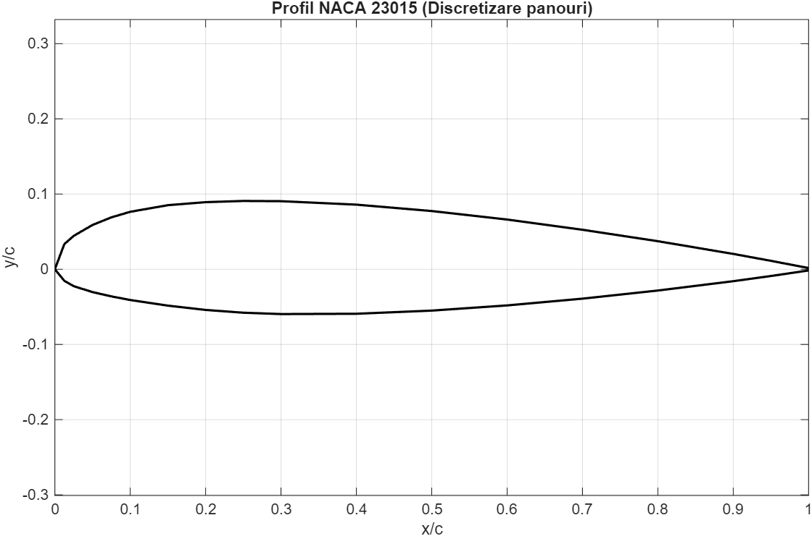
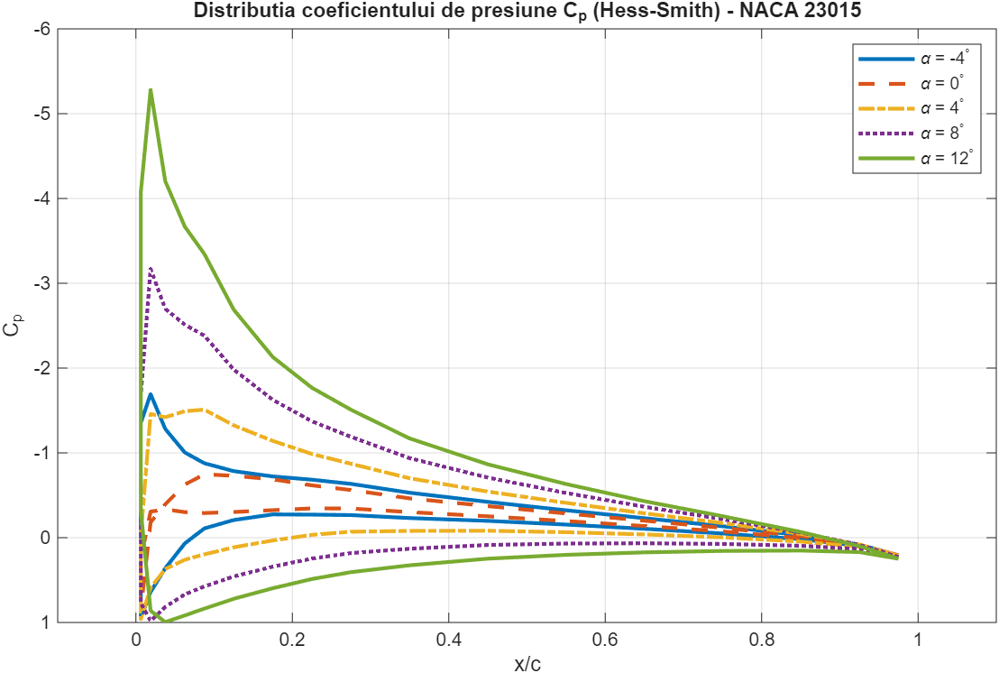
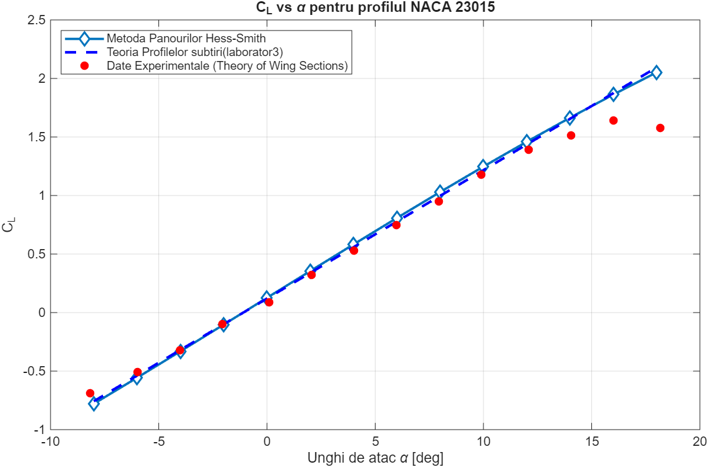
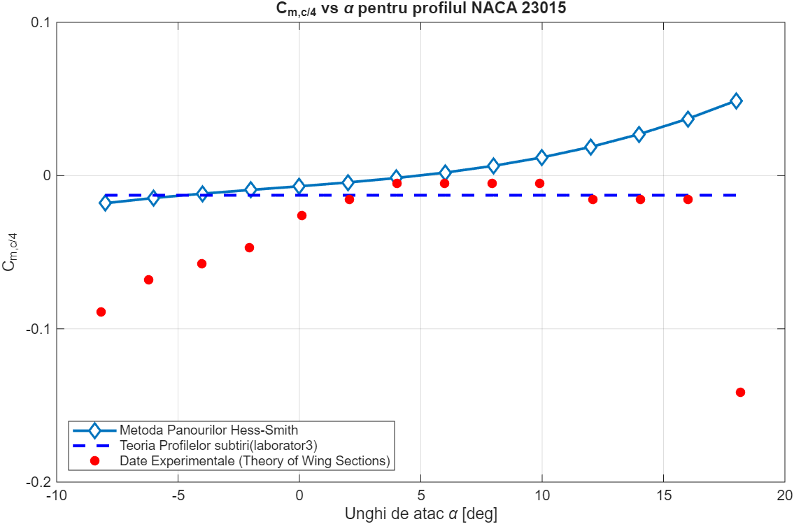

# Computational Aerodynamics: NACA Airfoil Generator, Thin Airfoil Theory & Hess-Smith Panel Method

A complete MATLAB framework for low-speed aerodynamics analysis, integrating parametric airfoil geometry generation, classical Thin Airfoil Theory (Glauert), and the Hess-Smith Panel Method. Developed to test the theory at the **National University of Science and Technology POLITEHNICA Bucharest (UPB)** coursework **Aerodynamics of Aircraft and Missiles (AAR)**.

---

## Repository Structure & Files

| File Name | Description | Airfoils Analyzed |
| :--- | :--- | :--- |
| `naca_airfoil_generator.m` | Parametric NACA 4-digit, 4-digit modified & 5-digit geometry generator with cosine spacing | NACA 44015, NACA 55010, NACA 0012 |
| `thin_airfoil_theory.m` | Analytical Glauert Thin Airfoil Theory solver using symbolic/VPA Fourier expansion ($A_0, A_1, A_2$) | NACA 23015 |
| `Hess_Smith.m` | Unified Source-Vortex Hess-Smith Panel Method & Thin Airfoil Theory comparison solver | NACA 23015 |
| `cl_exp.txt`, `cm_exp.txt` | Experimental wind tunnel datasets digitized via *WebPlotDigitizer* from *Abbott & von Doenhoff* | NACA 23015 |
| `*.dat` | Exported upper and lower surface coordinate files (`x/c`, `y/c`) | NACA 0012, NACA 55010 |

---

## 1. Parametric NACA Airfoil Geometry Generation (`naca_airfoil_generator.m`)

This module implements a general geometry generator for **NACA 4-digit**, **Modified NACA 4-digit**, and **NACA 5-digit** wing sections:
* **Cosine Spacing Discretization:** Uses $x = 0.5(1 - \cos\beta)$ with $N_p = 300$ points per surface to cluster nodes near the leading and trailing edges where curvature gradients are steepest.
* **Camber & Thickness Superposition:** Evaluates the mean camber line $y_c(x)$, its local slope $\theta = \arctan(dy_c/dx)$, and projects the thickness distribution $y_t(x)$ perpendicular to the camber line to obtain the upper $(x_u, y_u)$ and lower $(x_l, y_l)$ coordinates.

### Generated NACA 44015 Profile ($C_{L,\text{design}} = 0.6$, $PQ = 40$, $T = 15\%$)

### Geometry Comparison: Cambered NACA 44015 vs. Symmetrical NACA 0012

---

## 2. Classical Thin Airfoil Theory (`thin_airfoil_theory.m`)

This module evaluates the inviscid, incompressible aerodynamic characteristics of the **NACA 23015** airfoil for $\alpha \in [-8^\circ, 14^\circ]$ by modeling the airfoil through its piecewise mean camber line (inflection point at $x/c = 0.2025$):
$$z_c(x) = \begin{cases} 2.6595(x^3 - 0.6075x^2 + 0.1147x), & 0 \le x \le 0.2025 \\ 0.02208(1 - x), & 0.2025 < x \le 1.0 \end{cases}$$

Using the Glauert transformation $x(\theta) = \frac{1}{2}(1 - \cos\theta)$, the Fourier coefficients $A_0, A_1, A_2$ are computed via variable-precision integration (`vpaintegral`) to determine the theoretical lift and quarter-chord pitching moment:
$$C_L = \pi(2A_0 + A_1), \quad C_{m,c/4} = \frac{\pi}{4}(A_2 - A_1)$$

### Lift Coefficient Validation ($C_L$ vs. $\alpha$)

### Quarter-Chord Pitching Moment Validation ($C_{m,c/4}$ vs. $\alpha$)

---

## 3. Hess-Smith Panel Method & Experimental Validation (`Hess_Smith.m`)

The final module combines **Thin Airfoil Theory** with a full numerical implementation of the **Hess-Smith Source-Vortex Panel Method** over $\alpha \in [-8^\circ, 18^\circ]$ at $V_\infty = 87.6\text{ m/s}$, using physical coordinates from the **UIUC Airfoil Database** and experimental measurements digitized from *Theory of Wing Sections* (Abbott & von Doenhoff) via **WebPlotDigitizer**.

* **Mathematical Model:** Discretizes the airfoil contour into $N$ flat panels with constant source strength $\sigma_j$ and uniform bound vorticity $\gamma$. Enforcing flow tangency at panel midpoints and the **Kutta condition** at the trailing edge forms a coupled $(N+1)\times(N+1)$ linear system.
* **Physical Insights:**
  1. **Linear Regime & Thickness Effects:** Both theoretical models accurately predict the zero-lift angle of attack, but Hess-Smith provides higher accuracy by capturing flow displacement caused by the real $15\%$ airfoil thickness.
  2. **High-Angle-of-Attack Stall:** At high $\alpha$, both potential-flow methods diverge from experimental data because they neglect viscosity and boundary-layer separation (stall).
  3. **Pitching Moment & Pressure Distribution:** Hess-Smith tracks the stable, near-zero experimental $C_{m,c/4}$ evolution much better than Thin Airfoil Theory, while the surface pressure coefficient $C_p(x/c)$ clearly illustrates lift generation through upper-surface suction peak amplification.

### Panel Discretization of the NACA 23015 Geometry

### Surface Pressure Coefficient Distribution ($C_p$ vs. $x/c$)

### Lift Coefficient Comparison: Hess-Smith vs. Thin Airfoil Theory vs. Experiment

### Quarter-Chord Pitching Moment Comparison ($C_{m,c/4}$ vs. $\alpha$)

---

## References & Data Sources

1. **Abbott, I. H., & von Doenhoff, A. E.** (1959). *Theory of Wing Sections: Including a Summary of Airfoil Data*. Dover Publications. *(Experimental curves digitized using WebPlotDigitizer).*
2. **Katz, J., & Plotkin, A.** (2001). *Low-Speed Aerodynamics: From Vortex Theory to Numerical Methods*. Cambridge University Press.
3. **UIUC Applied Aerodynamics Group** – *UIUC Airfoil Coordinates Database* (NACA 23015 coordinates).
4. **National University of Science and Technology POLITEHNICA Bucharest (UPB)** – *Aerodynamics of Aircraft and Missiles (AAR) Coursework & Laboratory Guidelines*.
